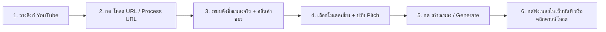

<div align="center">

# 🎤 AICoverGen (Local Edition)

**สร้าง AI Song Cover ด้วยเสียงที่คุณต้องการ — Create AI-powered song covers with any voice**  
*ปรับปรุงพิเศษ: เมนูภาษาไทย, ระบบถอดชื่อเพลงอัตโนมัติ, เครื่องเล่นเพลงในตัว, และรองรับการ์ดจอ VRAM 4GB*

[](https://www.python.org/)
[](https://pytorch.org/)
[](https://developer.nvidia.com/cuda-toolkit)
[](https://gradio.app/)
[](LICENSE)
[](rvc_models/public_models.json)

[🚀 Online Demo](https://huggingface.co/spaces/r3gm/AICoverGen) · [📙 Colab](https://colab.research.google.com/github/R3gm/AICoverGen/blob/main/colab_notebook.ipynb) · [🐛 Troubleshooting](TROUBLESHOOTING.md)

</div>

---

## ✨ Key Features | ฟีเจอร์เด่น

| หมวดหมู่ | รายละเอียด (TH) | Description (EN) |
| :--- | :--- | :--- |
| 🏷️ **Smart Song Naming** | ดึงชื่อเพลงจริงจาก YouTube + คลีนคำขยะ (`[Official MV]`, `4K`, `HD`) ไฟล์ผลลัพธ์เป็น `<ชื่อเพลง> (<โมเดล> Ver).mp3` ทันที | Auto-fetches real song title, strips noise tags (`[MV]`, `4K`), exports as `<Title> (<Model> Ver).mp3` |
| 🔊 **Dual Player & Download** | มี **เครื่องเล่นเพลง (gr.Audio)** ฟังเพลงในเว็บได้ทันที พร้อม **กล่องดาวน์โหลดไฟล์ (gr.File)** แยกชัดเจน | Dual UI outputs: instant in-browser audio player with waveform + separate 1-click file download card |
| 🎙️ **59+ Voice Models** | โหลดเสียงศิลปิน/ตัวละครดังได้ใน 1 คลิกจาก Public Index (Ado, YOASOBI, Nont Tanont, Villager ฯลฯ) | One-click downloads from curated catalog of 59+ public RVC models |
| ⚡ **Low-VRAM Optimized** | ออกแบบมาสำหรับ GPU 4GB (เช่น RTX 2050) ด้วยโหมด FP16 Half-Precision + Dynamic MDX | Seamlessly runs on 4GB GPUs (e.g. RTX 2050) using FP16 and single-thread MDX separation |
| 💻 **Cyberpunk Launcher** | หน้าต่าง Terminal สวยงาม บอกขั้นตอนการรัน real-time, ตรวจจับการ์ดจอ และเคลียร์พอร์ตอัตโนมัติ | High-aesthetic terminal launcher with live hardware telemetry, port resolver & pipeline streaming |
| 🌐 **Bilingual UI** | หน้าจอใช้งาน 2 ภาษา ไทย 🇹🇭 และ อังกฤษ 🇬🇧 ชัดเจนทุกเมนู | Intuitive bilingual interface in Thai and English |

---

## 📸 Screenshots | ภาพตัวอย่างหน้าจอ

<div align="center">

### 🎼 Generate Tab (หน้าสร้างเพลง พร้อมเครื่องเล่นและช่องชื่อเพลง)


### 📥 Download Model Tab (หน้าคลังโมเดลเสียง)


</div>

---

## 🚀 Quick Start | เริ่มต้นใช้งาน (Windows)

### 1️⃣ วิธีที่ง่ายที่สุด (แนะนำ)
ดับเบิลคลิกที่ไฟล์:
```batch
run_aicovergen.bat
```
> 💡 **Smart Launcher ทำอะไรให้บ้าง?**  
> ตรวจสอบและปิด process เก่าที่ค้างบน Port 7860 ➔ เช็ค Python Environment ➔ เปิด WebUI ➔ ตรวจสอบความพร้อมและแสดง URL `http://127.0.0.1:7860`

### 2️⃣ วิธีรันผ่านสคริปต์อื่น ๆ

| ตัวเปิดโปรแกรม | คำสั่ง | คำอธิบาย |
| :--- | :--- | :--- |
| 🪟 **PowerShell** | `powershell -ExecutionPolicy Bypass -File start_webui.ps1` | รันบน PowerShell พร้อมระบบเช็คสถานะ |
| 🐍 **Python Launcher** | `python launch.py` | Launcher แสดงผลพร้อมสีและแถบสถานะ |
| ⌨️ **Classic CMD** | `start_simple.bat` | รันแบบเรียบง่ายผ่าน Command Prompt |
| 🔧 **Manual Terminal** | `.\.venv\Scripts\python.exe src\webui.py --listen --listen-port 7860` | รันตรงเข้าสคริปต์หลัก |

> 🛑 **วิธีปิดโปรแกรม:** กด `Ctrl + C` ในหน้าต่าง Terminal (ระบบจะปิด Process ทั้งหมดอย่างปลอดภัย)

---

## 🎵 Step-by-Step Guide | ขั้นตอนการสร้างเพลง Cover



1. **เลือกโมเดลเสียง (Voice Model):**
   * ไปที่แท็บ **โหลดโมเดล / Download model** เพื่อเลือกโหลดเสียงที่ต้องการ (เช่น `NontTanont`, `Ado`, `Minecraft_Villager`)
   * หรือหากมีโมเดลของตัวเอง ให้นำไฟล์ `.pth` และ `.index` ไปวางในโฟลเดอร์ `rvc_models/<ชื่อโมเดล>/` แล้วกดปุ่ม **รีเฟรชโมเดล / Refresh 🔁**
2. **ใส่เพลงต้นฉบับ:**
   * วางลิงก์ YouTube ในช่อง แล้วกดปุ่ม **"โหลด URL / Process URL"**
   * ไฟล์จะถูกบันทึกเป็นชื่อเพลงต้นฉบับจริง (เช่น `สุดใจ.mp3`) และชื่อเพลงจะถูกนำไปกรอกในช่อง **"ชื่อเพลงสำหรับตั้งชื่อไฟล์ผลลัพธ์"** โดยอัตโนมัติ (สามารถพิมพ์แก้ไขชื่อได้ตามต้องการ)
   * *(หรือกดอัปโหลดไฟล์เพลงจากเครื่องโดยตรง)*
3. **ปรับระดับเสียง (Pitch):**
   * **แปลงเสียง ชาย ➔ หญิง:** ปรับ `+1` (หรือ 12 Semitones)
   * **แปลงเสียง หญิง ➔ ชาย:** ปรับ `-1` (หรือ -12 Semitones)
   * **เพศเดียวกัน:** คงไว้ที่ `0`
4. **กด "สร้างเพลง / Generate":**
   * รอระบบแยกเสียงดนตรี ➔ แปลงเสียงด้วย RVC ➔ ผสมเสียง Reverb
   * เมื่อเสร็จสิ้น สามารถ **กดฟังเพลงใน WebUI ได้ทันทีผ่านเครื่องเล่นเพลง** หรือ **กดคลิกเพื่อดาวน์โหลดไฟล์ `.mp3`**

> 📛 **รูปแบบชื่อไฟล์ผลลัพธ์:** `<ชื่อเพลงต้นฉบับ> (<ชื่อโมเดล> Ver).mp3`  
> เช่น: `สุดใจ (NontTanont Ver).mp3` หรือ `Blank Space (Ado Ver).mp3`

---

## ⏱️ Terminal Live Timing | ตัวอย่างเวลาประมวลผล

```text
  ─────────────────────────────────────────────────────────────
  ⚡ [PIPELINE STARTED] Processing audio cover workflow...
  ⬇️  [1/6] Downloading YouTube audio stream...
  🎼  [2/6] Separating Vocals & Instrumental (MDX-Net)...
  🔮  [3/6] Isolating Lead Vocals & Removing Backup (UVR-KARA)...
  ✨  [4/6] De-reverberating Vocal Stems (FoxJoy HQ)...
  🎙️  [5/6] Converting Vocal Timbre with RVC v2 Model...
  🎛️  [6/6] Mastering with Studio Effects & Reverb...
  🎵  [FINAL] Merging Vocals & Instrumental Stems...
  💾  Cover generated at song_output\Shape of You (NontTanont Ver).mp3
  🏆  Total time all process: 00:01:24
  ─────────────────────────────────────────────────────────────
```

---

## 💻 System Requirements | ความต้องการของระบบ

| อุปกรณ์ | สเปกขั้นต่ำ / แนะนำ | หมายเหตุ |
| :--- | :--- | :--- |
| 🐍 **Python** | **3.10.x** | ใช้ผ่าน `.venv` ของโปรเจกต์ (PyTorch + Fairseq ต้องใช้ 3.10) |
| 🎮 **GPU** | **NVIDIA GPU (CUDA 12+)** | ทดสอบและปรับแต่งพิเศษสำหรับ **RTX 2050 (VRAM 4GB)** ✅ |
| 💾 **Drive Space** | แนะนำพื้นที่ว่างอย่างน้อย 20GB | สำหรับจัดเก็บโมเดลเสียง, โมเดลแยกเสียง และผลลัพธ์เพลง Cover |
| 🎵 **FFmpeg** | ติดตั้งมาพร้อมไลบรารีในตัว | ไม่ต้องลงโปรแกรมแยก |

---

## 📂 โครงสร้างโฟลเดอร์สำคัญ (Project Layout)

```text
AICoverGen/
├── 🚀 run_aicovergen.bat            # ดับเบิลคลิกเริ่มใช้งานทันที (One-click Launcher)
├── 🐍 launch.py                     # Cyberpunk Terminal Launcher (ANSI & Telemetry)
├── 🪟 start_webui.ps1              # สคริปต์สำหรับรันบน PowerShell
├── 📁 src/
│   ├── 🖥️ webui.py                 # หน้าเว็บ Gradio WebUI (Bilingual + Dual Outputs)
│   ├── ⚙️ main.py                  # Core Cover Pipeline + Real Song Title Sanitizer
│   ├── 🎤 mdx.py                   # โมดูลแยกเสียงร้อง/ดนตรี (MDX-Net ONNX)
│   └── 🗣️ rvc.py                   # โมดูลแปลงเสียง AI (Retrieval-based Voice Conversion)
├── 🎙️ rvc_models/                  # ที่เก็บโมเดลเสียง RVC (.pth, .index)
├── 🎼 mdxnet_models/                # โมเดลแยกเสียง ONNX
└── 🎵 song_output/                  # โฟลเดอร์ผลลัพธ์เพลง AI Cover
```

---

## 🆘 Troubleshooting | คำถามที่พบบ่อยและวิธีแก้ปัญหา

* 🔌 **พอร์ต 7860 ชน / หน้าเว็บไม่ขึ้น:**  
  ดับเบิลคลิก `run_aicovergen.bat` อีกครั้ง ระบบจะช่วย Kill Process เก่าที่ค้างอยู่และเริ่มใหม่ให้อัตโนมัติ
* 🔤 **ชื่อเพลงภาษาไทยหรืออักขระพิเศษ:**  
  ระบบรองรับภาษาไทย, ญี่ปุ่น, จีน และ Unicode เต็มรูปแบบ โดยจะแยกการประมวลผลภายในเป็น ASCII-Safe เพื่อป้องกันไลบรารี C++ แครช และแปลงกลับเป็นชื่อเพลงภาษาไทยในขั้นตอนสุดท้าย
* 🔒 **เจอปัญหาดาวน์โหลดโมเดลจาก Hugging Face ติดสิทธิ์ (Error 401/403):**  
  เข้าเว็บ huggingface.co ไปที่หน้ารายการโมเดลนั้น แล้วกดยอมรับเงื่อนไข จากนั้นสร้าง Access Token ฟรีที่ `huggingface.co/settings/tokens` แล้วนำมาวางในช่อง **🔑 HF Token** ในแท็บ Download Model

---

## 🙏 Credits & Acknowledgments

* Fork พัฒนาต่อยอดจาก [R3gm/AICoverGen](https://github.com/R3gm/AICoverGen) (ต้นฉบับโดย [SociallyIneptWeeb/AICoverGen](https://github.com/SociallyIneptWeeb/AICoverGen))
* **RVC Project:** [RVC-Project/Retrieval-based-Voice-Conversion-WebUI](https://github.com/R3gm/Retrieval-based-Voice-Conversion-WebUI)
* **MDX-Net:** Ultimate Vocal Remover GUI ([Anjok07](https://github.com/Anjok07/ultimatevocalremovergui))
* โมเดลเสียงสาธารณะทั้งหมด จัดทำโดยคอมมูนิตี้ AI Music ขอขอบคุณผู้สร้างโมเดลทุกท่าน (ดูรายละเอียดเครดิตใน `rvc_models/public_models.json`)
