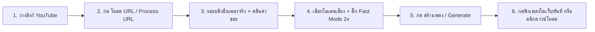

<div align="center">

# 🎤 AICoverGen (Local Edition)

**สร้าง AI Song Cover ด้วยเสียงที่คุณต้องการ — Create AI-powered song covers with any voice**  
*ปรับปรุงพิเศษ: เมนูภาษาไทย, ระบบถอดชื่อเพลงอัตโนมัติ, เครื่องเล่นเพลงในตัว, และรองรับการ์ดจอ VRAM 4GB*

[](https://www.python.org/)
[](https://pytorch.org/)
[](https://developer.nvidia.com/cuda-toolkit)
[](https://gradio.app/)
[](LICENSE)
[](rvc_models/public_models.json)

[🚀 Online Demo](https://huggingface.co/spaces/r3gm/AICoverGen) · [📙 Colab](https://colab.research.google.com/github/R3gm/AICoverGen/blob/main/colab_notebook.ipynb) · [🐛 Troubleshooting](TROUBLESHOOTING.md)

</div>

---

## ✨ Key Features | ฟีเจอร์เด่น

| หมวดหมู่ | รายละเอียด (TH) | Description (EN) |
| :--- | :--- | :--- |
| 🏷️ **Smart Song Naming** | ดึงชื่อเพลงจริงจาก YouTube + คลีนคำขยะ (`[Official MV]`, `4K`, `HD`) ไฟล์ผลลัพธ์เป็น `<ชื่อเพลง> (<โมเดล> Ver).mp3` ทันที | Auto-fetches real song title, strips noise tags (`[MV]`, `4K`), exports as `<Title> (<Model> Ver).mp3` |
| ⚡ **Fast Mode (2x Speed)** | แยกเสียงร้องเร็วกว่าเดิม 2 เท่า (Default: ON) ลดเวลาลง ~50% เหลือเพียง 2-3 นาทีบน GPU 4GB ด้วยการปรับลำดับ ONNX ให้กระชับ | 2x faster MDX vocal isolation (Default: ON), cuts run time by ~50% down to 2-3 mins on 4GB GPUs |
| 🎧 **Cyberpunk Audio Player** | เครื่องเล่นเพลง Custom Theme นีออนแบบ In-Memory แสดงจุดเลื่อนเพลง (Scrubber Thumb) ตลอดเวลา 100% โดยไม่ต้องเอาเมาส์ชี้, ป้องกัน IDM ดักจับ, ไม่มี Auto-Download กวนใจ, แก้ปัญหาค้าง 0:00 และคงสระภาษาไทยครบถ้วน | Custom Cyberpunk in-memory player: 100% permanent scrubber thumb visibility (no hover needed), IDM-safe, zero auto-downloads, eliminates 0:00 freeze, full Thai Unicode support |
| 🎙️ **59+ Voice Models** | โหลดเสียงศิลปิน/ตัวละครดังได้ใน 1 คลิกจาก Public Index (Ado, YOASOBI, Nont Tanont, Villager ฯลฯ) | One-click downloads from curated catalog of 59+ public RVC models |
| 🎮 **Low-VRAM & Auto-Flush** | ปรับแต่งพิเศษสำหรับ GPU 4GB (RTX 2050) ด้วย FP16 + Dynamic MDX พร้อมระบบ Auto-Flush คืนหน่วยความจำ VRAM ทุกขั้นตอน | Built for 4GB GPUs with FP16, single-thread MDX & automatic VRAM cache flushing between stages |
| 💻 **Cyberpunk Launcher** | หน้าต่าง Terminal จัดระเบียบ Sub-steps สวยงาม, คำนวณ RVC Speed (x Real-time), ป้ายเตือน Amber Runtime Notice ชัดเจน, หลอด Progress Bar คมชัด และเคลียร์พอร์ตอัตโนมัติ | High-aesthetic terminal launcher with clean sub-steps, RVC inference speed multiplier, Amber runtime notices & live telemetry |
| 🛡️ **Diagnostic & Crash Guard** | กล่องสรุป Error แบบ Cyberpunk Diagnostic Card พร้อมตัวกรอง WinError 10054 และ Crash Pause Guard หน้าต่างไม่ปิดหนีเมื่อเกิดข้อผิดพลาด | Cyberpunk error diagnostic card with WinError 10054 noise filtering, full traceback drainer, and crash pause guard |
| 🌐 **Bilingual UI** | หน้าจอใช้งาน 2 ภาษา ไทย 🇹🇭 และ อังกฤษ 🇬🇧 ชัดเจนทุกเมนู | Intuitive bilingual interface in Thai and English |

---

## 📸 Screenshots | ภาพตัวอย่างหน้าจอ

<div align="center">

### 🎼 Generate Tab (หน้าสร้างเพลง พร้อมเครื่องเล่นและช่องชื่อเพลง)


### 📥 Download Model Tab (หน้าคลังโมเดลเสียง)


</div>

---

## 🚀 Quick Start | เริ่มต้นใช้งาน (Windows)

### 1️⃣ วิธีที่ง่ายที่สุด (แนะนำ)
ดับเบิลคลิกที่ไฟล์:
```batch
run_aicovergen.bat
```
> 💡 **Smart Launcher ทำอะไรให้บ้าง?**  
> ตรวจสอบและปิด process เก่าที่ค้างบน Port 7860 ➔ เช็ค Python Environment ➔ เปิด WebUI ➔ ตรวจสอบความพร้อมและแสดง URL `http://127.0.0.1:7860`

### 2️⃣ วิธีรันผ่านสคริปต์อื่น ๆ

| ตัวเปิดโปรแกรม | คำสั่ง | คำอธิบาย |
| :--- | :--- | :--- |
| 🪟 **PowerShell** | `powershell -ExecutionPolicy Bypass -File start_webui.ps1` | รันบน PowerShell พร้อมระบบเช็คสถานะ |
| 🐍 **Python Launcher** | `python launch.py` | Launcher แสดงผลพร้อมสีและแถบสถานะ |
| ⌨️ **Classic CMD** | `start_simple.bat` | รันแบบเรียบง่ายผ่าน Command Prompt |
| 🔧 **Manual Terminal** | `.\.venv\Scripts\python.exe src\webui.py --listen --listen-port 7860` | รันตรงเข้าสคริปต์หลัก |

> 🛑 **วิธีปิดโปรแกรม:** กด `Ctrl + C` ในหน้าต่าง Terminal (ระบบจะปิด Process ทั้งหมดอย่างปลอดภัย)

---

## 🎵 Step-by-Step Guide | ขั้นตอนการสร้างเพลง Cover



1. **เลือกโมเดลเสียง (Voice Model):**
   * ไปที่แท็บ **โหลดโมเดล / Download model** เพื่อเลือกโหลดเสียงที่ต้องการ (เช่น `NontTanont`, `Ado`, `Minecraft_Villager`)
   * หรือหากมีโมเดลของตัวเอง ให้นำไฟล์ `.pth` และ `.index` ไปวางในโฟลเดอร์ `rvc_models/<ชื่อโมเดล>/` แล้วกดปุ่ม **รีเฟรชโมเดล / Refresh 🔁**
2. **ใส่เพลงต้นฉบับ:**
   * วางลิงก์ YouTube ในช่อง แล้วกดปุ่ม **"โหลด URL / Process URL"**
   * ไฟล์จะถูกบันทึกเป็นชื่อเพลงต้นฉบับจริง (เช่น `สุดใจ.mp3`) และชื่อเพลงจะถูกนำไปกรอกในช่อง **"ชื่อเพลงสำหรับตั้งชื่อไฟล์ผลลัพธ์"** โดยอัตโนมัติ (สามารถพิมพ์แก้ไขชื่อได้ตามต้องการ)
   * *(หรือกดอัปโหลดไฟล์เพลงจากเครื่องโดยตรง)*
3. **ปรับระดับเสียง (Pitch):**
   * **แปลงเสียง ชาย ➔ หญิง:** ปรับ `+1` (หรือ 12 Semitones)
   * **แปลงเสียง หญิง ➔ ชาย:** ปรับ `-1` (หรือ -12 Semitones)
   * **เพศเดียวกัน:** คงไว้ที่ `0`
4. **โหมดประมวลผลความเร็วสูง (⚡ Fast Mode):**
   * ⚡ **เปิดใช้งาน Fast Mode (ค่าเริ่มต้น - แนะนำ):** แยกเสียงร้องเร็วกว่าเดิม 2 เท่า ลดเวลาเหลือเพียง ~2-3 นาทีบน RTX 2050 เหมาะอย่างยิ่งสำหรับเพลง Pop/Rock ทั่วไป
   * 🎧 **ปิด Fast Mode:** สำหรับกรณีที่ต้องการคุณภาพแยกเสียงระดับสตูดิโอสูงสุดแบบ Multi-pass Denoising (เช่น เพลงที่มีเสียงคอรัสหรือเสียงเอฟเฟกต์หนาแน่นเป็นพิเศษ)
5. **กด "สร้างเพลง / Generate":**
   * รอระบบแยกเสียงดนตรี ➔ แปลงเสียงด้วย RVC ➔ ผสมเสียง Reverb
   * เมื่อประมวลผลเสร็จสิ้น การ์ด **Cyberpunk Audio Player** แบบ Custom Controller จะแสดงขึ้นมาทันที:
     * 🎧 **กดฟังเพลงได้ทันทีในเบราว์เซอร์:** มีปุ่ม Play/Pause สไตล์นีออน และปุ่มปรับระดับเสียง/Mute
     * 📍 **เห็นตำแหน่งเพลงตลอดเวลา (Permanent Scrubber):** จุดเลื่อนเพลง (Thumb) เรืองแสงและแถบสีสถานะแสดงผลตลอดเวลา 100% ไม่หายไปแม้นำเมาส์ออกจากเครื่องเล่น
     * 🛡️ **ปลอดภัยจาก IDM:** ป้องกันโปรแกรม IDM เด้งดาวน์โหลดอัตโนมัติ และป้องกันปัญหาเครื่องเล่นค้างที่ 0:00
     * 💾 **ปุ่มดาวน์โหลดไฟล์ (.mp3) ในตัว:** คลิกเพื่อดาวน์โหลดลงเครื่องได้ทันที โดยชื่อเพลงและสระภาษาไทย (`ั`, `้`, `ุ`) จะคงอยู่ครบถ้วน 100%

> 📛 **รูปแบบชื่อไฟล์ผลลัพธ์:** `<ชื่อเพลงต้นฉบับ> (<ชื่อโมเดล> Ver).mp3`  
> เช่น: `สุดใจ (NontTanont Ver).mp3` หรือ `ฉบับท้ายสุด (NontTanont Ver).mp3`

---

## ⏱️ Terminal Live Timing | ตัวอย่างเวลาประมวลผล

```text
  ─────────────────────────────────────────────────────────────
  ⚡ [PIPELINE STARTED] Processing audio cover workflow...
     🛡️  [ASCII-Safe Routing] Activated for Thai/Unicode audio track
  ⬇️  [1/6] Downloading YouTube audio stream...
  🎼  [2/6] Separating Vocals & Instrumental (MDX-Net Fast Mode)...
     🎮  [ONNX Engine] CUDA Execution Provider active (GPU 0)
     💾  [VRAM Allocation] Dynamic MDX limit: 4.0 GB
     ⚡ MDX [████████████████░░░░] 80% | 64/80 chunks | ETA: 7s
     🧹 GPU VRAM cache flushed successfully.
  🔮  [3/6] Isolating Lead Vocals & Removing Backup (UVR-KARA)...
  ✨  [4/6] De-reverberating Vocal Stems (FoxJoy HQ)...
  🎙️  [5/6] Converting Vocal Timbre with RVC v2 Model...
     ✔   [RVC Weights] All model weight keys matched successfully
     ⚡  [RVC Speed] Inferred in 14.5s (Audio: 4m 14s | 17.5x Real-time)
  🎛️  [6/6] Mastering with Studio Effects & Reverb...
     ✨  [Audio Mastering] Neural noise reduction applied
  🎵  [FINAL] Merging Vocals & Instrumental Stems...
  💾  Cover generated at song_output\ฉบับท้ายสุด (NontTanont Ver).mp3
  🏆  Total time all process: 00:02:18 (⚡ Fast Mode ON)
  ─────────────────────────────────────────────────────────────
  ⚠️  [RUNTIME NOTICE] Python 3.10 active (standard engine for PyTorch + Fairseq)
```

---

## 💻 System Requirements | ความต้องการของระบบ

| อุปกรณ์ | สเปกขั้นต่ำ / แนะนำ | หมายเหตุ |
| :--- | :--- | :--- |
| 🐍 **Python** | **3.10.x** | ใช้ผ่าน `.venv` ของโปรเจกต์ (PyTorch + Fairseq ต้องใช้ 3.10) |
| 🎮 **GPU** | **NVIDIA GPU (CUDA 12+)** | ทดสอบและปรับแต่งพิเศษสำหรับ **RTX 2050 (VRAM 4GB)** ✅ |
| 💾 **Drive Space** | แนะนำพื้นที่ว่างอย่างน้อย 20GB | สำหรับจัดเก็บโมเดลเสียง, โมเดลแยกเสียง และผลลัพธ์เพลง Cover |
| 🎵 **FFmpeg** | ติดตั้งมาพร้อมไลบรารีในตัว | ไม่ต้องลงโปรแกรมแยก |

---

## 📂 โครงสร้างโฟลเดอร์สำคัญ (Project Layout)

```text
AICoverGen/
├── 🚀 run_aicovergen.bat            # ดับเบิลคลิกเริ่มใช้งานทันที (One-click Launcher)
├── 🐍 launch.py                     # Cyberpunk Terminal Launcher (ANSI & Telemetry)
├── 🪟 start_webui.ps1              # สคริปต์สำหรับรันบน PowerShell
├── 📁 src/
│   ├── 🖥️ webui.py                 # หน้าเว็บ Gradio WebUI (Bilingual + Dual Outputs)
│   ├── ⚙️ main.py                  # Core Cover Pipeline + Real Song Title Sanitizer
│   ├── 🎤 mdx.py                   # โมดูลแยกเสียงร้อง/ดนตรี (MDX-Net ONNX)
│   └── 🗣️ rvc.py                   # โมดูลแปลงเสียง AI (Retrieval-based Voice Conversion)
├── 🎙️ rvc_models/                  # ที่เก็บโมเดลเสียง RVC (.pth, .index)
├── 🎼 mdxnet_models/                # โมเดลแยกเสียง ONNX
└── 🎵 song_output/                  # โฟลเดอร์ผลลัพธ์เพลง AI Cover
```

---

## 🆘 Troubleshooting | คำถามที่พบบ่อยและวิธีแก้ปัญหา

* 🔌 **พอร์ต 7860 ชน / หน้าเว็บไม่ขึ้น:**  
  ดับเบิลคลิก `run_aicovergen.bat` อีกครั้ง ระบบจะช่วย Kill Process เก่าที่ค้างอยู่และเริ่มใหม่ให้อัตโนมัติ
* 🛡️ **ระบบวินิจฉัยข้อผิดพลาด (Error Diagnostic Card & Crash Guard):**  
  หากกระบวนการทำงานสะดุดหรือมีข้อผิดพลาด Launcher จะจับ Stacktrace ทั้งหมดและแสดงผลเป็นการ์ดสรุปปัญหา พร้อมระบบ **Crash Pause Guard** (ค้างหน้าต่าง Terminal ไว้ไม่ให้ปิดหนีอัตโนมัติ) เพื่อให้คุณอ่านหรือ Copy Log ไปวิเคราะห์ได้ทันที:
  ```text
  ╭─ EXCEPTION DIAGNOSTIC DETECTED ─────────────────────────────╮
  │ TYPE:    RuntimeError / CUDA OOM                            │
  │ LOC:     src\mdx.py:128                                     │
  │ MESSAGE: CUDA out of memory. Tried to allocate 256.00 MiB   │
  │ TRACE:   Traceback (most recent call last):                 │
  │            File "src\main.py", line 186, in song_cover_pipeline
  │            File "src\mdx.py", line 128, in run_mdx          │
  ╰─────────────────────────────────────────────────────────────╯
  Press Enter to exit...
  ```
* 🔤 **ชื่อเพลงภาษาไทยหรืออักขระพิเศษ:**  
  ระบบรองรับภาษาไทย, ญี่ปุ่น, จีน และ Unicode เต็มรูปแบบ โดยจะแยกการประมวลผลภายในเป็น ASCII-Safe เพื่อป้องกันไลบรารี C++ แครช และแปลงกลับเป็นชื่อเพลงภาษาไทยในขั้นตอนสุดท้าย
* 🎧 **ปัญหา IDM ดักดาวน์โหลด / แถบตำแหน่งเพลงหายเมื่อไม่ชี้เมาส์ / เครื่องเล่นค้าง 0:00 / สระภาษาไทยหาย:**  
  * **ปัญหาเดิมของ WebUI:**
    1. หากเบราว์เซอร์ติดตั้ง Extension ช่วยดาวน์โหลด เช่น Internet Download Manager (IDM) เมื่อสร้างเพลงเสร็จ ระบบ WebUI ทั่วไปจะส่งไฟล์ผ่าน HTTP GET ทำให้ IDM เข้าดักจับตัดการเชื่อมต่อ ส่งผลให้เครื่องเล่นเสียงค้างที่ `0:00 / 0:00`, มีหน้าต่างดาวน์โหลดเด้งขึ้นมากวนใจทันที และระบบ Sanitizer ของ IDM มักจะตัดสระภาษาไทย (เช่น `ั`, `้`, `ุ`) ออก ทำให้ชื่อเพลงผิดเพี้ยน (เช่น `ฉบับท้ายสุด` กลายเป็น `ฉบบทายสด`)
    2. ตัวเล่นของเบราว์เซอร์ Chromium (Chrome/Edge) บังคับซ่อนจุดเลื่อนสถานะเพลง (Timeline Scrubber Thumb) เมื่อไม่ได้นำเมาส์ไปชี้ ทำให้ไม่ทราบว่าเพลงเล่นถึงจุดใด
  * **การแก้ไขของ AICoverGen:** พัฒนา **Custom Cyberpunk Audio Controller** ที่แปลงข้อมูลเป็น In-Memory Base64 Data URI และสร้างแถบควบคุมแบบ Dark Glass นีออนเฉพาะตัว:
    * 📍 **เห็นตำแหน่งเพลงตลอดเวลา (Permanent Scrubber):** จุด Thumb เรืองแสงและแถบสีสถานะเพลงแสดงผลเด่นชัดตลอดเวลา 100% โดยไม่ต้องเอาเมาส์ไปชี้
    * 🛡️ **ไม่ถูก IDM ดักจับ 100%:** ไม่มีหน้าต่างดาวน์โหลดเด้งขึ้นมาเองกวนใจ
    * ⚡ **เล่นได้ทันที:** พร้อมปุ่ม Play/Pause นีออน, ตัวเลขอ่านเวลา `0:00 / 2:32`, แถบ Seek bar ปรับท่อนเพลง และปุ่มปรับระดับเสียง/Mute
    * 💾 **คงสระภาษาไทยครบถ้วน:** มีปุ่ม `💾 ดาวน์โหลดเพลง (.mp3)` ในตัวที่ส่งต่อชื่อไฟล์ UTF-8 ให้เบราว์เซอร์บันทึกลงเครื่องโดยตรง
* 🔇 **ข้อความเตือน `ConnectionResetError: [WinError 10054]` เมื่อกดรีเฟรชหน้าเว็บ (Windows Asyncio Filter):**  
  บน Windows เมื่อผู้ใช้กดรีเฟรชเบราว์เซอร์ (F5) หรือปิดแท็บ ขณะที่เซิร์ฟเวอร์กำลังรอคำขอ ระบบเครือข่ายของ Windows Proactor Loop จะเกิดอีเวนต์ Client Disconnect ซึ่งเป็นพฤติกรรมปกติ ไม่ใช่ข้อผิดพลาดของโมเดล AI หรือโปรแกรมแครช AICoverGen ได้ติดตั้งตัวกรองระดับ Transport Layer และ Launcher เพื่อดักจับและระงับข้อความดังกล่าว ทำให้ Terminal สะอาดและไม่แสดงเป็นการ์ดสีแดงแจ้งเตือนผิดพลาด
* 🔒 **เจอปัญหาดาวน์โหลดโมเดลจาก Hugging Face ติดสิทธิ์ (Error 401/403):**  
  เข้าเว็บ huggingface.co ไปที่หน้ารายการโมเดลนั้น แล้วกดยอมรับเงื่อนไข จากนั้นสร้าง Access Token ฟรีที่ `huggingface.co/settings/tokens` แล้วนำมาวางในช่อง **🔑 HF Token** ในแท็บ Download Model

---

## 🙏 Credits & Acknowledgments

* Fork พัฒนาต่อยอดจาก [R3gm/AICoverGen](https://github.com/R3gm/AICoverGen) (ต้นฉบับโดย [SociallyIneptWeeb/AICoverGen](https://github.com/SociallyIneptWeeb/AICoverGen))
* **RVC Project:** [RVC-Project/Retrieval-based-Voice-Conversion-WebUI](https://github.com/R3gm/Retrieval-based-Voice-Conversion-WebUI)
* **MDX-Net:** Ultimate Vocal Remover GUI ([Anjok07](https://github.com/Anjok07/ultimatevocalremovergui))
* โมเดลเสียงสาธารณะทั้งหมด จัดทำโดยคอมมูนิตี้ AI Music ขอขอบคุณผู้สร้างโมเดลทุกท่าน (ดูรายละเอียดเครดิตใน `rvc_models/public_models.json`)
