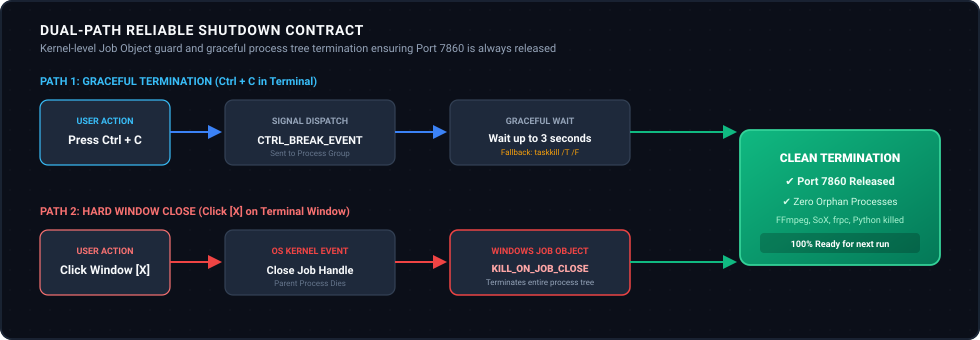
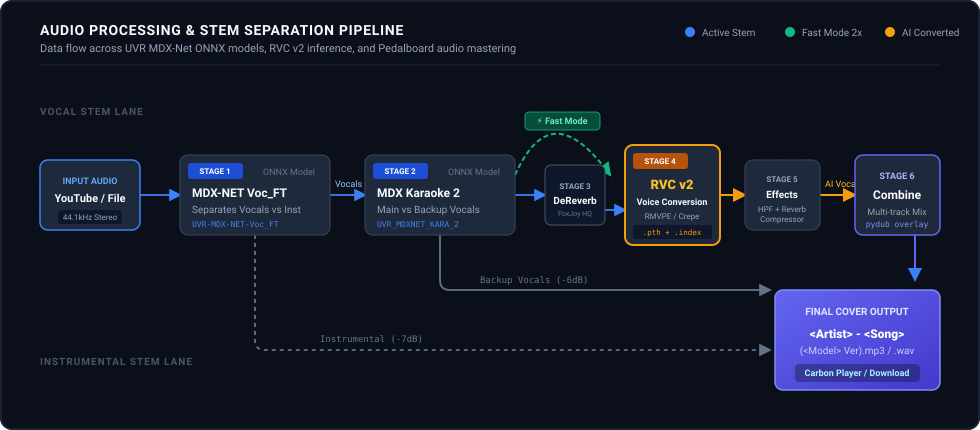
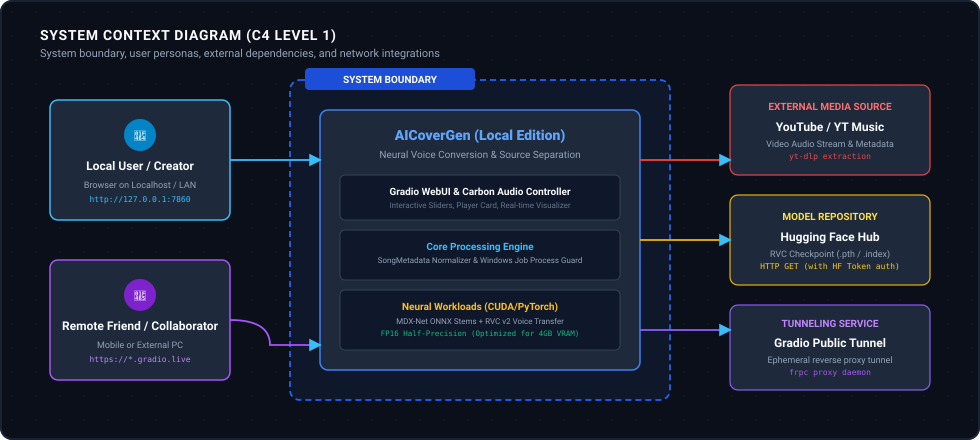
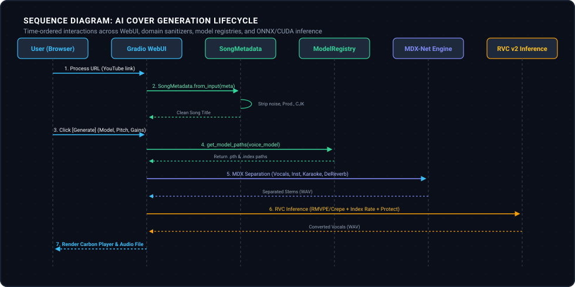

<div align="center">

# 🎤 AICoverGen (Local Edition)

**สร้าง AI Song Cover คุณภาพสตูดิโอด้วยเสียงที่คุณต้องการ — Create AI-powered song covers with any voice**  
*ปรับแต่งพิเศษ: เมนูภาษาไทย 🇹🇭, ระบบถอดชื่อเพลงอัจฉริยะ, ตัวเล่นเพลง Carbon Player, ระบบปิดโปรแกรมไร้ Orphan Process, และรองรับ GPU VRAM 4GB สมบูรณ์แบบ*

<p align="center">
  <a href="https://www.python.org/"></a>
  <a href="https://pytorch.org/"></a>
  <a href="https://developer.nvidia.com/cuda-toolkit"></a>
  <a href="https://gradio.app/"></a>
  <a href="https://github.com/microsoft/terminal"></a>
  <a href="LICENSE"></a>
</p>

[🚀 Online Demo](https://huggingface.co/spaces/r3gm/AICoverGen) · [📙 Colab Notebook](https://colab.research.google.com/github/R3gm/AICoverGen/blob/main/colab_notebook.ipynb) · [🛠️ Troubleshooting Guide](TROUBLESHOOTING.md)

</div>

---

## 📌 สารบัญ | Table of Contents
- [✨ จุดเด่นและฟีเจอร์ใหม่ (Key Features)](#-จุดเด่นและฟีเจอร์ใหม่--key-features)
- [📸 ภาพตัวอย่างหน้าจอ (Screenshots)](#--ภาพตัวอย่างหน้าจอ--screenshots)
- [🚀 เริ่มต้นใช้งานบน Windows (Quick Start)](#--เริ่มต้นใช้งานบน-windows--quick-start)
- [🎵 ขั้นตอนการสร้างเพลง Cover (Step-by-Step Guide)](#--ขั้นตอนการสร้างเพลง-cover--step-by-step-guide)
- [🔍 ตรวจสอบเนื้อร้อง (Lyrics Checker)](#--ตรวจสอบเนื้อร้อง-lyrics-checker)
- [💻 หน้าต่าง Terminal Carbon Console (Live Telemetry)](#--หน้าต่าง-terminal-carbon-console--live-telemetry)
- [🛑 ระบบปิดโปรแกรมอย่างปลอดภัย (Reliable Shutdown Contract)](#--ระบบปิดโปรแกรมอย่างปลอดภัย--reliable-shutdown-contract)
- [📐 แผนภาพสถาปัตยกรรมและกระบวนการทำงาน (System Diagrams)](#--แผนภาพสถาปัตยกรรมและกระบวนการทำงาน--system-diagrams)
- [💻 ความต้องการของระบบ (System Requirements)](#--ความต้องการของระบบ--system-requirements)
- [📂 โครงสร้างโปรเจกต์ (Project Layout)](#--โครงสร้างโปรเจกต์--project-layout)
- [🆘 ปัญหาที่พบบ่อยและวิธีแก้ (Troubleshooting)](#--ปัญหาที่พบบ่อยและวิธีแก้--troubleshooting)
- [🙏 เครดิตและผู้พัฒนา (Credits & Acknowledgments)](#--เครดิตและผู้พัฒนา--credits--acknowledgments)

---

## ✨ จุดเด่นและฟีเจอร์ใหม่ | Key Features

| หมวดหมู่ | รายละเอียด (TH) | Description (EN) |
| :--- | :--- | :--- |
| 🏷️ **Smart Song & Artist Formatter** | ดึงชื่อศิลปินและชื่อเพลงจาก YouTube / YouTube Music จัดฟอร์แมตมาตรฐานสากล `[ศิลปิน] - [ชื่อเพลง]` พร้อมแปลงฟอนต์พิเศษด้วย NFKC Normalization, **ระบบสลับตำแหน่งเพลง-ศิลปินอัตโนมัติ (Smart Inversion)** หากคลิปตั้งชื่อเอาเพลงขึ้นก่อน, **กวาดล้างแท็กโปรโมทและเครดิตโปรดิวเซอร์หมดจด**: ตัด `(Prod. by ...)`, `[PROD. BY ...]`, `(Produced by ...)`, `[ MV]`, `[M/V]`, `【 MV 】`, `Official Lyrics Video`, `|...|`, `//...//`, จัดโครงสร้าง `Feat. [ศิลปิน]`, และใส่วงเล็บ Romaji ภาษาญี่ปุ่น/เกาหลีให้อัตโนมัติ | Full-spectrum title extraction: auto-detects `[Artist] - [Song]`, smart song-artist inversion matching YouTube channel identity, removes producer credits (`Prod. by ...`, `Produced by`) & MV tags (`[ MV]`, `[M/V]`, `【MV】`), extended promo noise cleaning, Romaji transliteration, and CJK support. |
| 🛑 **Reliable Shutdown Guard** | ระบบยกเลิกและปิดโปรแกรมระดับ Kernel ผ่าน **Windows Job Object (`JOB_OBJECT_LIMIT_KILL_ON_JOB_CLOSE`)**: กด `Ctrl+C` เพื่อหยุดอย่างนุ่มนวล หรือคลิกปุ่ม **กากบาท (X)** ของหน้าต่าง Terminal เพื่อยกเลิกและคืนพอร์ต 7860 ทันที 100% ไร้ Process ตกค้าง | Kernel-level process lifecycle: Windows Job Object guarantees immediate tree termination upon closing terminal (`X`) or `Ctrl+C`, preventing orphaned WebUI/FFmpeg processes. |
| 🌐 **Public Share Launcher** | สคริปต์เปิดแชร์ภายนอกโดยเฉพาะ (`run_aicovergen_share.bat`) เชื่อมต่อ Gradio Tunnel (`https://<id>.gradio.live`) ชั่วคราว แสดง URL ใน Carbon Console พร้อมใช้งานทันที โดยสคริปต์ปกติยังคงเป็น Local-only เพื่อความปลอดภัย | Dedicated opt-in public launcher generating temporary `*.gradio.live` HTTPS endpoints with real-time tunnel status telemetry in Carbon Console. |
| 📁 **Dedicated Downloads & 1-Click Purge** | จัดเก็บไฟล์ดาวน์โหลดจาก YouTube ไว้ในโฟลเดอร์เฉพาะ `downloads/` ไม่ปะปนกับโฟลเดอร์ระบบ พร้อมปุ่ม `[ 🗑️ ล้างดาวน์โหลด / Clear ]` บน WebUI ให้ล้างไฟล์แคชได้ในคลิกเดียว | Isolates raw media downloads in `downloads/` with a 1-click purge button on the WebUI to reclaim disk space instantly. |
| ⚡ **Fast Mode (2x Speed)** | แยกเสียงร้องเร็วกว่าเดิม 2 เท่า (เปิดเป็นค่าเริ่มต้น) ลดเวลาแยกเสียงลง ~50% เหลือเพียง 2-3 นาทีบน GPU VRAM 4GB ด้วยการปรับลำดับ ONNX ให้กระชับคงความคมชัดของเสียงร้อง | 2x faster vocal separation (Default: ON), halving MDX inference duration down to 2-3 mins on 4GB VRAM without vocal timbre loss. |
| 🎧 **Carbon Theme Audio Player** | เครื่องเล่นเพลง Custom HTML5 ดีไซน์หรูสอดรับกับ IBM Carbon Theme พร้อมปุ่มควบคุม Carbon Blue (`#0f62fe`), แสดงจุดเลื่อนเพลง (Scrubber Thumb) ถาวร 100%, ป้องกัน IDM ดักดาวน์โหลด, แก้ปัญหาค้าง 0:00, และคงสระภาษาไทยสมบูรณ์ | Theme-adaptive HTML5 player matching IBM Carbon style tokens, featuring permanent scrubber visibility, IDM interception immunity, and lossless UTF-8 Thai diacritics. |
| 🎙️ **59+ Voice Models & Thai Unicode** | ดาวน์โหลดโมเดลเสียงศิลปิน/ตัวละครดังได้ใน 1 คลิกจาก Public Index และรองรับโฟลเดอร์โมเดลภาษาไทย 100% (เช่น โต ซิลลี่ฟูลส์, จ๋าย ไททศมิตร) ด้วย In-Memory FAISS Index Deserializer ไม่แครช | 1-click model downloads from 59+ public catalog; native support for Thai Unicode model folder names via in-memory FAISS deserialization. |
| 🎮 **Low-VRAM & Auto-Flush** | ปรับแต่งพิเศษสำหรับ GPU 4GB (RTX 2050 / GTX 1650) ด้วย FP16 Half-Precision + Single-Thread MDX (กิน VRAM จริงเพียง ~1.5 GB) พร้อมระบบ Auto-Flush คืนหน่วยความจำทุกขั้นตอน | Engineered for 4GB GPUs with FP16 precision, single-thread MDX safety, and automatic GPU VRAM cache purges between pipeline stages. |
| 💻 **Carbon Console Launcher** | หน้าต่าง Terminal จัดเต็มด้วย ANSI IBM Carbon Palette (`#4589ff` + `#525252`), กรอบมุมมนอ่านสบายตา, จัดระเบียบขั้นตอนประมวลผลชัดเจน, ซ่อน Warning กวนใจ, พร้อม Live GPU/VRAM Telemetry | Sleek IBM Carbon themed console launcher with high-contrast typography, border boxes, stream progress indicators, and deprecation notice suppression. |
| 🛡️ **Diagnostic & Crash Guard** | กล่องสรุป Error แบบ Carbon Diagnostic Card พร้อมตัวกรอง WinError 10054 และ Crash Pause Guard หน้าต่างไม่ปิดหนีเมื่อเกิดข้อผิดพลาด | Carbon error diagnostic card with WinError 10054 noise filtering, full traceback buffer drainer, and crash pause guard. |
| 🌐 **Bilingual UI** | หน้าจอใช้งาน 2 ภาษา ไทย 🇹🇭 และ อังกฤษ 🇬🇧 ชัดเจนทุกเมนู | Intuitive bilingual interface in Thai and English across all tabs. |
| 🔍 **Lyrics Checker (Optional)** | ฟังเสียงร้องด้วย ASR (faster-whisper) แล้วเทียบกับเนื้อเพลงอ้างอิง รายงานความต่างที่น่าสงสัย (`substitution`/`omission`/`insertion`/`uncertain`) พร้อมเวลาระดับคำ/ระดับช่วง ปิดไว้โดยปริยาย ไม่กระทบการสร้างเพลงหลัก รองรับไทย-อังกฤษ + ขยายภาษาได้โดยไม่แตะ core | Optional ASR-based lyric verification with word/segment-level timestamps and extensible multilingual rules. Off by default; never blocks cover generation. Supports Thai & English. |
| 🔬 **Post-RVC Analysis (Optional)** | เทียบเสียงร้องต้นฉบับกับเสียงหลัง RVC ด้วย ASR ค่าเดียวกันทั้งสองฝั่ง รายงานแยก 5 เคส (อ้างอิง-vs-ต้นฉบับ/อ้างอิง-vs-หลัง RVC/Transcript-เทียบกัน/คุณภาพสัญญาณ/ข้อจำกัด) พร้อมเวลาอ้างอิงไฟล์หลัง RVC อ่านอย่างเดียว ไม่แตะ RVC settings ไม่ลบไฟล์ cover | Optional pre/post-RVC vocal comparison with same ASR settings on both sides. Read-only; never retunes RVC or deletes outputs. |

---

## 📸 ภาพตัวอย่างหน้าจอ | Screenshots

<div align="center">

### 🎼 Generate Tab (หน้าสร้างเพลง พร้อมเครื่องเล่นและช่องชื่อเพลง)


### 📥 Download Model Tab (หน้าคลังโมเดลเสียง)


</div>

---

## 🚀 เริ่มต้นใช้งานบน Windows | Quick Start

### 1️⃣ โหมดใช้งานในเครื่อง / เครือข่ายเดียวกัน (Local / LAN Mode)
ดับเบิลคลิกที่ไฟล์:
```batch
run_aicovergen.bat
```
> 💡 **Smart Launcher ทำงานอัตโนมัติ:**  
> เคลียร์พอร์ตที่ค้าง ➔ เช็คสภาพแวดล้อม Python `.venv` ➔ เปิด Gradio WebUI ➔ ผูกระบบ Windows Job Object ➔ พร้อมใช้งานที่ `http://127.0.0.1:7860`

### 2️⃣ โหมดเปิดลิงก์สาธารณะชั่วคราว (Public Share Mode)
เมื่อต้องการเปิดให้เพื่อนภายนอกเข้าใช้งาน หรือเปิดจากมือถือนอกบ้าน:
```batch
run_aicovergen_share.bat
```
> 🌐 **Public Share Launcher ทำงานอย่างไร:**  
> ระบบจะเปิด Gradio HTTPS Tunnel และแสดง URL สาธารณะใน Terminal ทันที เช่น:  
> `Public URL : https://xxxxxxxxxxxxxxxxxx.gradio.live`  
> *(ลิงก์จะทำงานตราบเท่าที่เปิดหน้าต่าง Terminal และจะยุติการทำงานทันทีเมื่อปิดหน้าต่าง)*

### 3️⃣ ตัวเลือกการรันอื่น ๆ (Alternative Run Scripts)

| ตัวเปิดโปรแกรม | คำสั่ง | คำอธิบาย |
| :--- | :--- | :--- |
| 🪟 **PowerShell** | `powershell -ExecutionPolicy Bypass -File start_webui.ps1` | รันบน PowerShell พร้อมระบบเช็คสถานะ |
| 🐍 **Python Direct** | `python launch.py` หรือ `python launch.py --share` | Launcher แสดงผลพร้อม ANSI Telemetry |
| ⌨️ **Classic CMD** | `start_simple.bat` | รันแบบเรียบง่ายผ่าน Command Prompt |
| 🔧 **Manual Terminal** | `.\.venv\Scripts\python.exe src\webui.py --listen --listen-port 7860` | รันตรงเข้าสคริปต์หลัก |

---

## 🛑 ระบบปิดโปรแกรมอย่างปลอดภัย | Reliable Shutdown Contract

AICoverGen ติดตั้งระบบควบคุมวงจรชีวิตโปรเซส (Process Lifecycle Management) แบบ 2 ทิศทาง:

<div align="center">
  <picture>
    <source media="(prefers-color-scheme: dark)" srcset="images/shutdown_diagram.svg">
    <source media="(prefers-color-scheme: light)" srcset="images/shutdown_diagram_light.svg">
    
  </picture>
</div>


1. **กด `Ctrl + C` ใน Terminal:**
   * สั่งระงับการทำงานอย่างนุ่มนวล (Graceful Shutdown)
   * ปิดการประมวลผลโมเดลและ Gradio Tunnel อย่างปลอดภัย
   * ปิดหน้าต่างลงทันทีโดยไม่ต้องกดปุ่มยืนยันซ้ำ
2. **คลิกปุ่มกากบาท (`X`) ที่มุมหน้าต่าง:**
   * ระบบ **Windows Job Object** ในระดับ OS Kernel จะตัดการทำงานของโปรเซสย่อยทั้งหมดทันที (WebUI, FFmpeg, SoX, Python Worker, `frpc`)
   * พอร์ต 7860 จะถูกปล่อยเป็นอิสระทันที ไม่เกิดปัญหาพอร์ตชนเมื่อเปิดโปรแกรมใหม่

---

## 🎵 ขั้นตอนการสร้างเพลง Cover | Step-by-Step Guide

<div align="center">
  <picture>
    <source media="(prefers-color-scheme: dark)" srcset="images/pipeline_diagram.svg">
    <source media="(prefers-color-scheme: light)" srcset="images/pipeline_diagram_light.svg">
    
  </picture>
</div>


1. **เลือกโมเดลเสียง (Voice Model):**
   * ไปที่แท็บ **โหลดโมเดล / Download model** เพื่อเลือกโหลดเสียงที่ต้องการ (เช่น `NontTanont`, `Ado`, `Minecraft_Villager`)
   * หรือหากมีโมเดลของตัวเอง ให้นำไฟล์ `.pth` และ `.index` ไปวางในโฟลเดอร์ `rvc_models/<ชื่อโมเดล>/` แล้วกดปุ่ม **รีเฟรชโมเดล / Refresh 🔁**
2. **ใส่เพลงต้นฉบับ:**
   * วางลิงก์ YouTube / YouTube Music ในช่อง แล้วกดปุ่ม **"โหลด URL / Process URL"**
   * ไฟล์จะถูกดาวน์โหลดเก็บแยกในโฟลเดอร์ `downloads/<ศิลปิน> - <ชื่อเพลง>.mp3`
   * 🏷️ **ระบบจัดรูปแบบชื่อเพลงอัจฉริยะ (Smart Formatter):**
     * จัดรูปแบบเป็นสากล `[ศิลปิน] - [ชื่อเพลง]` พร้อมคลีนฟอนต์พิเศษด้วย NFKC Normalization
     * **สลับตำแหน่งเพลง-ศิลปินอัตโนมัติ (Smart Inversion):** หากคลิปตั้งชื่อเอาเพลงขึ้นก่อน เช่น `โฆษณาชวนเลือก - TaitosmitH |Official Lyrics Video|` ระบบจะเทียบกับชื่อช่องและสลับกลับมาเป็น `TaitosmitH - โฆษณาชวนเลือก` ให้อัตโนมัติ พร้อมลบคำขยะและเครื่องหมายไปป์ `|...|` ออกหมดจด
     * **กวาดล้างแท็กเครดิต Prod. และแท็กวิดีโอ (Clean Noise & Producer Tags):** ตัดแท็กขยะออกอัตโนมัติทั้งพิมพ์เล็กและพิมพ์ใหญ่ เช่น:
       * เครดิตโปรดิวเซอร์: `(Prod. by TRILOGY)`, `[PROD. BY ...]`, `(prod by ...)`, `(Produced by ...)`, `- Prod. by ...`
       * แท็ก MV/วิดีโอ: `[ MV]`, `[MV]`, `[ M/V ]`, `( MV )`, `【 MV 】`, `[Official MV]`
       * ปลอดภัย ไม่กระทบชื่อเพลงปกติที่มีคำว่า Prod หรือ Product (เช่น `Product of Love`, `Prodigy`)
     * **ถอดเสียง Romaji อัตโนมัติ:** หากเป็นเพลงภาษาญี่ปุ่นหรือเกาหลี ระบบจะใส่วงเล็บ `(Romaji)` ติดกับชื่อเพลงเดิม (เช่น `藍より群青 (Ai Yori Gunjou)` หรือ `밤양갱 (Bam-Yang-Gaeng)`) โดยไม่กระทบเพลงไทยหรือสากล
     * **แยกศิลปิน Feat. สวยงาม:** จัดโครงสร้างศิลปินร่วมร้องเป็น `Feat. [ศิลปิน]` เช่น `Takaaki Natsushiro - 藍より群青 (Ai Yori Gunjou) Feat. Suisei Hoshimachi`
   * 🧹 **ปุ่มล้างแคช:** กดปุ่ม **"🗑️ ล้างดาวน์โหลด / Clear"** เพื่อล้างไฟล์ชั่วคราวใน `downloads/` ได้ทุกเมื่อ
3. **ปรับระดับเสียง (Pitch):**
   * **แปลงเสียง ชาย ➔ หญิง:** ปรับ `+1` (หรือ 12 Semitones)
   * **แปลงเสียง หญิง ➔ ชาย:** ปรับ `-1` (หรือ -12 Semitones)
   * **เพศเดียวกัน:** คงไว้ที่ `0`
4. **โหมดประมวลผลความเร็วสูง (⚡ Fast Mode):**
   * ⚡ **เปิดใช้งาน Fast Mode (ค่าเริ่มต้น - แนะนำ):** แยกเสียงร้องเร็วกว่าเดิม 2 เท่า ลดเวลาเหลือเพียง ~2-3 นาทีบน RTX 2050
   * 🎧 **ปิด Fast Mode:** สำหรับกรณีที่ต้องการคุณภาพแยกเสียงระดับสตูดิโอสูงสุดแบบ Multi-pass Denoising
5. **กด "สร้างเพลง / Generate":**
   * เมื่อเสร็จสิ้น การ์ด **Carbon Theme Audio Player** จะแสดงขึ้นมาทันที:
     * 🎧 **กดฟังเพลงได้ทันทีในเบราว์เซอร์:** ควบคุมเสียง เล่น/หยุด ปรับท่อนเพลงได้อย่างลื่นไหล
     * 📍 **เห็นตำแหน่งเพลงตลอดเวลา (Permanent Scrubber):** จุดเลื่อนเพลงสีน้ำเงินเด่นชัดตลอดเวลา 100%
     * 🛡️ **ปลอดภัยจาก IDM:** ป้องกันโปรแกรม IDM เด้งตัดการเชื่อมต่อ และป้องกันปัญหาเครื่องเล่นค้าง 0:00
     * 💾 **ปุ่มดาวน์โหลดไฟล์ (.mp3) ในตัว:** คลิกเพื่อดาวน์โหลดลงเครื่องทันที พร้อมคงสระภาษาไทยครบถ้วน 100%

> 📛 **รูปแบบชื่อไฟล์ผลลัพธ์ (Clean Output Naming):**  
> ระบบจะนำชื่อที่ผ่านการคลีนและจัดฟอร์แมตแล้วมาตั้งชื่อไฟล์ผลลัพธ์:  
> `<ชื่อศิลปิน> - <ชื่อเพลง> (<ชื่อโมเดล> Ver).mp3`  
>  
> ✨ **ตัวอย่างผลลัพธ์การคลีนชื่อไฟล์:**  
> - `ชื่อคลิป YouTube: ZENTYARB - ฉบับท้ายสุด (Prod. by TRILOGY) [Official MV]`  
>   ➔ ผลลัพธ์: `ZENTYARB - ฉบับท้ายสุด (Ado Ver).mp3`  
> - `ชื่อคลิป YouTube: Liz's x NATNON - เพลงรัก (Prod. by TRILOGY) [Official MV]`  
>   ➔ ผลลัพธ์: `Liz's x NATNON - เพลงรัก (Ado Ver).mp3`  
> - `ชื่อคลิป YouTube: [ MV] Takaaki Natsushiro - 藍より群青 feat. Suisei Hoshimachi (prod by ...)`  
>   ➔ ผลลัพธ์: `Takaaki Natsushiro - 藍より群青 (Ai Yori Gunjou) Feat. Suisei Hoshimachi (Ado Ver).mp3`  
> - `ชื่อคลิป YouTube: BIBI (비비) - 밤양갱 [Official M/V]`  
>   ➔ ผลลัพธ์: `BIBI - 밤양갱 (Bam-Yang-Gaeng) (NontTanont Ver).mp3`  

---

## 🔍 ตรวจสอบเนื้อร้อง | Lyrics Checker

ระบบเสริม (ปิดไว้โดยปริยาย) ใช้ ASR ฟังเสียงร้องแล้วเทียบกับเนื้อร้องที่คุณวางไว้ เหมาะสำหรับเช็กว่าเนื้อเพลงต้นฉบับตรงกับที่ร้องจริงหรือไม่ **ก่อน/หลัง** แปลงเสียง RVC:

1. **ติดตั้ง dependency เสริม (ครั้งเดียว):**
   ```powershell
   .\.venv\Scripts\pip install "faster-whisper>=1.0.0"
   ```
   > ⚠️ หาก MDX แยกเสียงบน GPU ไม่ทำงานหลังติดตั้ง (เมนู CUDA หาย) ให้รันคำสั่งนี้เพื่อคืน `onnxruntime-gpu`:
   > ```powershell
   > .\.venv\Scripts\pip uninstall -y onnxruntime
   > .\.venv\Scripts\pip install "onnxruntime-gpu==1.22.0" "numpy==1.23.5" "sympy==1.13.1"
   > ```
2. **เปิดใช้งาน:** แท็บสร้างเพลง → กาง Accordion **ตรวจสอบเนื้อร้อง / Lyrics Checker** → ติ๊กเปิดใช้
3. **วางเนื้อเพลงอ้างอิงทั้งเพลงตามลำดับท่อน** (ถ้าวางแค่ท่อนฮุก ท่อนอื่นจะโดนรายงานว่าขาด)
4. **เลือกภาษา** (`th`/`en` หรือ `auto`) **ขนาดโมเดล** (ค่าเริ่มต้น `base` + `cpu` ปลอดภัยกับ VRAM 4GB) และ**โหมดเวลา** (`word` = เวลาระดับคำ / `segment` = เวลาระดับช่วง / `none` = ไม่แสดงเวลา) แล้วกด **ตรวจสอบเนื้อร้อง / Check lyrics**
5. **อ่านรายงาน:** การ์ดความต่างที่น่าสงสัย (`substitution`/`omission`/`insertion`/`uncertain`) ผูกกับช่วงเวลาจริง — ข้อความยาวพับไว้กดดูเพิ่มได้ แสดงสูงสุด 50 จุด รายงานแยก **ภาษาที่เลือก vs ภาษาที่ตรวจพบ** (พร้อม probability ซึ่งอาจผิดสำหรับเพลงร้อง) เสมอ

> 💡 **ข้อควรรู้:** ASR ฟังเสียงร้องเพลงได้ไม่สมบูรณ์ ผลต่างอาจมาจากเทคนิคการร้อง เสียงดนตรีปน หรือ ASR เอง — **ไม่ใช่หลักฐานว่า RVC เปลี่ยนเนื้อร้อง** ควรฟังเสียงต้นฉบับตรง timestamp นั้นเทียบก่อนเสมอ | Singing ASR is imperfect; mismatches are suspicions, not proof of changed lyrics.
>
> ⏱️ **ระดับเวลา (Phase 2):** `word` = เวลาระดับคำจาก ASR (เชื่อถือได้สูงสุด) · `segment` = เวลาระดับช่วงจาก segment จริง (หยาบกว่า ใช้เมื่อ word-level ไม่น่าเชื่อถือ) · `none`/`—` = ไม่มีเวลาที่เชื่อถือได้ ระบบ**ไม่สร้างเวลาปลอม**ด้วยการหารเฉลี่ยความยาวเพลงเด็ดขาด
>
> 🌐 **หลายภาษา (Phase 2):** มีจุดต่อ normalizer/tokenizer แยกตามภาษา (ปัจจุบัน `th`/`en` ใช้กฎพื้นฐานชุดเดียวกัน ยังไม่มีกฎเฉพาะภาษา) ภาษาไทยไร้ช่องว่างจึงเทียบแบบ chunk — ทุกจุดต่างคือข้อสงสัยให้ตรวจด้วยหู ไม่ใช่คำผิดแน่นอน ภาษาเพิ่มขยายได้ด้วย `register_language()` โดยไม่ต้องเขียนระบบเทียบใหม่ (เช่น `register_language("ja", "Japanese")`)
>
> 🔒 **เวลาระดับคำ (F.1 guard):** ระบบแปะเวลาระดับคำเฉพาะเมื่อตัวอักษรของช่วงคำ ASR ตรงกับข้อความที่น่าสงสัยจริง (ตรวจเนื้อหา ไม่นับจำนวน) ถ้าพิสูจน์ไม่ได้จะตกไปใช้เวลาระดับช่วงหรือ `—` แทน
>
> 🎲 **ASR ไม่คงที่ 100%:** โมเดลใช้ temperature fallback (0.0→1.0) เพื่อฟังท่อนร้องยากๆ ได้ ผลถอดเสียงอาจต่างกันเล็กน้อยระหว่างรอบ ควรยึด timestamp ที่ตรวจสอบด้วยหูแล้วเป็นหลัก 

### 🔍 ตรวจสอบหลัง RVC (Phase 3, optional)

กาง Accordion **ตรวจสอบหลัง RVC / Post-RVC Analysis** แล้วเลือกไฟล์เสียงร้องต้นฉบับ (`*_Vocals_Main_DeReverb.wav`) กับเสียงหลัง RVC (`*_<voice>_..._.wav`) ระบบถอดเสียงทั้งสองฝั่งด้วย ASR ค่าเดียวกัน แล้วรายงานแยก 5 เคส: อ้างอิง-vs-ต้นฉบับ, อ้างอิง-vs-หลัง RVC, Transcript-ต้นฉบับ-vs-หลัง RVC (เวลาอ้างอิงไฟล์หลัง RVC), คุณภาพสัญญาณ (เงียบ/clipping/ความยาว), และข้อจำกัด — ไม่มีคะแนนรวมคะแนนเดียว ไม่แตะการตั้งค่า RVC ไม่ลบไฟล์ cover ที่สร้างแล้ว ถ้าไม่ให้เนื้อเพลงอ้างอิง เคสเทียบจะเป็นแค่การเทียบ Transcript ไม่ใช่การยืนยันเนื้อเพลง

---

## 💻 หน้าต่าง Terminal Carbon Console | Live Telemetry

เมื่อเปิดโปรแกรมผ่าน Launcher หน้าต่างคอนโซลจะแสดงผลแบบ Full IBM Carbon Theme:

```text
  ╭────────────────────────────────────────────────────────────────╮
  │  ▲  AICoverGen  v2.5 [CARBON CONSOLE]                          │
  │  Autonomous Neural Voice & Music Source Separation Engine      │
  ├────────────────────────────────────────────────────────────────┤
  │  ● SYSTEM TELEMETRY                                            │
  │  ├─ Hardware  : NVIDIA GeForce RTX 2050 (4.0 GB VRAM)          │
  │  ├─ Precision : FP16 Half-Precision (Tensor Core Optimized)    │
  │  ├─ Storage   : D:\AI_Cache (Drive C Protection Active)        │
  │  ├─ Voice Hub : 12 Installed / 59+ Catalog                     │
  │  └─ Runtime   : Python 3.10.11 (.venv / PyTorch 2.5.1+cu121)   │
  ╰────────────────────────────────────────────────────────────────╯
  [1/4] Verifying local socket availability...
        ✔ Port 7860 is clean and available
  [2/4] Inspecting Python virtual environment...
        ✔ Python 3.10.11 located at .venv
  [3/4] Spawning Gradio WebUI neural service...
        ✔ Process spawned successfully (PID: 35340)
  [4/4] Awaiting HTTP daemon readiness...
        ✔ CUDA device confirmed: FP16 half-precision active

  ╭────────────────────────────────────────────────────────────────╮
  │  ★ WEBUI IS READY & LISTENING                                  │
  ├────────────────────────────────────────────────────────────────┤
  │                                                                │
  │    Local URL  : http://127.0.0.1:7860                          │
  │    Network    : http://0.0.0.0:7860                            │
  │    Public URL : https://58987f07421eff6d5e.gradio.live         │
  │                                                                │
  │  ● WORKFLOW GUIDE:                                             │
  │    1. Open URL in browser ➔ Go to [Generate] tab               │
  │    2. Paste YouTube link ➔ Click [Process URL]                 │
  │    3. Select Voice Model & Pitch ➔ Click [Generate]            │
  │    4. In-browser Player or 1-Click Download (.mp3)             │
  │                                                                │
  │  [Press Ctrl+C in terminal to safely terminate server]         │
  ╰────────────────────────────────────────────────────────────────╯
```

---

## 💻 ความต้องการของระบบ | System Requirements

| อุปกรณ์ | สเปกขั้นต่ำ / แนะนำ | หมายเหตุ |
| :--- | :--- | :--- |
| 🐍 **Python** | **3.10.x** | รันผ่าน `.venv` ของโปรเจกต์ (PyTorch + Fairseq รองรับ 3.10 สมบูรณ์ที่สุด) |
| 🎮 **GPU** | **NVIDIA GPU (CUDA 12+)** | ทดสอบและปรับแต่งพิเศษสำหรับ **RTX 2050 (VRAM 4GB)** และตระกูล GTX/RTX ทุกรุ่น |
| 💾 **Drive Space** | แนะนำพื้นที่ว่างอย่างน้อย 20GB | สำหรับจัดเก็บโมเดล RVC, โมเดลแยกเสียง ONNX และแคช AI |
| 🎵 **FFmpeg** | ติดตั้งมาพร้อมไลบรารีในตัว | ไม่จำเป็นต้องลงโปรแกรมภายนอกแยก |
| 🪟 **OS** | **Windows 10 / 11 (64-bit)** | รองรับ Windows Job Object และ UTF-8 Terminal Mode เต็มรูปแบบ |

---

## 📐 แผนภาพสถาปัตยกรรมและกระบวนการทำงาน | System Diagrams

ไดอะแกรมเชิงลึกรองรับทั้ง **Dark Mode** และ **Light Mode** อัตโนมัติตามธีมของ GitHub:

### 1️⃣ System Context Diagram (C4 Level 1)
แสดงขอบเขตของระบบ ผู้ใช้งานทั้งระดับ Local และการแชร์สาธารณะ พร้อมการเชื่อมต่อไปยัง YouTube, Hugging Face และ Gradio Tunnel:
<div align="center">
  <picture>
    <source media="(prefers-color-scheme: dark)" srcset="images/context_diagram.svg">
    <source media="(prefers-color-scheme: light)" srcset="images/context_diagram_light.svg">
    
  </picture>
</div>

---

### 2️⃣ Component Architecture Diagram (C4 Level 2)
แสดงโครงสร้างโมดูลหลัก 3 ชั้น: Presentation & Entrypoint Layer, Core Domain Layer (`SongMetadata`), และ Inference Engines (`MDX-Net`, `RVC v2`):
<div align="center">
  <picture>
    <source media="(prefers-color-scheme: dark)" srcset="images/component_diagram.svg">
    <source media="(prefers-color-scheme: light)" srcset="images/component_diagram_light.svg">
    
  </picture>
</div>

---

### 3️⃣ Sequence Diagram (AI Cover Generation Lifecycle)
แสดงลำดับขั้นการส่งข้อมูลแบบ Time-ordered Interaction ตั้งแต่เริ่มวางลิงก์ YouTube ➔ คลีนชื่อเพลง ➔ สแกนโมเดล ➔ แยกเสียงร้อง ➔ แปลงเสียง RVC ➔ รวมมิกซ์เพลง:
<div align="center">
  <picture>
    <source media="(prefers-color-scheme: dark)" srcset="images/sequence_diagram.svg">
    <source media="(prefers-color-scheme: light)" srcset="images/sequence_diagram_light.svg">
    
  </picture>
</div>

---

## 📂 โครงสร้างโปรเจกต์ | Project Layout

```text
AICoverGen/
├── 🚀 run_aicovergen.bat            # ดับเบิลคลิกเริ่มใช้งานทันที (Local / LAN Mode)
├── 🌐 run_aicovergen_share.bat      # เปิดแชร์ผ่าน Gradio Public Tunnel ชั่วคราว
├── 🐍 launch.py                     # IBM Carbon Terminal Launcher & Telemetry Engine
├── 🛡️ launcher_process.py          # Windows Job Object & Kernel Process Guard
├── 🪟 start_webui.ps1              # สคริปต์รันบน PowerShell พร้อมระบบตรวจเช็ค
├── 📁 downloads/                    # โฟลเดอร์เก็บไฟล์เสียงต้นฉบับที่ดาวน์โหลดจาก YouTube
├── 🧪 tests/                        # ชุดทดสอบอัตโนมัติ (Process Lifecycle & Shutdown E2E + Lyrics Checker)
├── 📁 src/
│   ├── 🖥️ webui.py                 # หน้าเว็บ Gradio WebUI (Bilingual + Carbon Audio Player)
│   ├── ⚙️ main.py                  # Core Engine & Audio Processing Pipeline
│   ├── 🏷️ song_metadata.py         # Deep Module: SongMetadata Domain & Multi-language Normalizer
│   ├── 🔍 lyrics/                   # Optional Lyrics Checker + Post-RVC (asr/compare/align/report/postrvc, fail-safe)
│   ├── 🎤 mdx.py                   # โมดูลแยกเสียงร้อง/ดนตรี (MDX-Net ONNX Fast Mode)
│   └── 🗣️ rvc.py                   # โมดูลแปลงเสียง AI (Retrieval-based Voice Conversion v2)
├── 🎙️ rvc_models/                  # ที่เก็บโมเดลเสียง RVC (.pth, .index)
├── 🎼 mdxnet_models/                # โมเดลแยกเสียง ONNX
└── 🎵 song_output/                  # โฟลเดอร์ผลลัพธ์เพลง AI Cover ที่สร้างเสร็จสมบูรณ์
```

---

## 🆘 ปัญหาที่พบบ่อยและวิธีแก้ | Troubleshooting

* 🔌 **พอร์ต 7860 ชน / หน้าเว็บไม่ขึ้น:**  
  ดับเบิลคลิก `run_aicovergen.bat` ระบบจะตรวจสอบพอร์ตและสั่งปิดโปรเซสเดิมที่ค้างอยู่ให้อัตโนมัติในขั้นตอนที่ 1
* 🛑 **วิธียกเลิกหรือปิดโปรแกรม:**  
  กด `Ctrl+C` หรือคลิกปุ่ม **กากบาท (X)** ของหน้าต่าง Terminal ระบบ Windows Job Object จะสั่งยุติการทำงานของโปรเซสย่อยทั้งหมดทันที พอร์ต 7860 จะว่างพร้อมเปิดใหม่ได้ทันที
* 🛡️ **ระบบวินิจฉัยข้อผิดพลาด (Crash Pause Guard):**  
  หากเกิดข้อผิดพลาด Launcher จะจับ Stacktrace ทั้งหมดและแสดงเป็นการ์ดสรุปปัญหา พร้อมค้างหน้าต่าง Terminal ไว้เพื่อให้อ่านหรือ Copy Log ได้ทันที:
  ```text
  ╭─ EXCEPTION DIAGNOSTIC DETECTED ─────────────────────────────╮
  │ TYPE:    RuntimeError / CUDA OOM                            │
  │ LOC:     src\mdx.py:128                                     │
  │ MESSAGE: CUDA out of memory. Tried to allocate 256.00 MiB   │
  │ TRACE:   Traceback (most recent call last):                 │
  │            File "src\main.py", line 186, in song_cover_pipeline
  │            File "src\mdx.py", line 128, in run_mdx          │
  ╰─────────────────────────────────────────────────────────────╯
  Press Enter to exit...
  ```
* 🎧 **ปัญหา IDM ดักดาวน์โหลด / สระภาษาไทยหาย:**  
  WebUI ใช้ **Carbon Custom Audio Controller** ทำงานผ่าน In-Memory Base64 Data URI ป้องกัน IDM ดักตัดการเชื่อมต่อ 100% สระภาษาไทย (`ั`, `้`, `ุ`) จะไม่สูญหาย และสามารถฟังเพลงพร้อมเลื่อนท่อนเพลงได้อย่างแม่นยำ
* 🔇 **ข้อความเตือน `ConnectionResetError: [WinError 10054]` เมื่อกดรีเฟรชหน้าเว็บ:**  
  เป็นพฤติกรรมปกติของ Windows Asyncio เมื่อผู้ใช้กด F5 หรือปิดแท็บเบราว์เซอร์ ระบบได้ติดตั้งตัวกรองระดับ Transport Layer เพื่อระงับข้อความดังกล่าวแล้ว ทำให้ Terminal สะอาดและไม่ขึ้นกล่องแดงผิดพลาด
* 🔒 **เจอปัญหาดาวน์โหลดโมเดลจาก Hugging Face ติดสิทธิ์ (Error 401/403):**  
  เข้าเว็บ huggingface.co ไปที่หน้ารายการโมเดลนั้น แล้วกดยอมรับเงื่อนไข จากนั้นสร้าง Access Token ฟรีที่ `huggingface.co/settings/tokens` แล้วนำมาวางในช่อง **🔑 HF Token** ในแท็บ Download Model
* 🔍 **Lyrics Checker ถอดเสียงได้ว่างเปล่า / เกือบว่าง:**  
  ระบบปิด VAD Filter เป็นค่าเริ่มต้นแล้วเพราะ VAD สำหรับเสียงพูดมักตัดเสียงร้องทิ้ง หากยังว่าง ให้ลองโมเดลใหญ่ขึ้น (`small`) หรือใช้ไฟล์เสียงร้องที่แยกแล้ว (`*_Vocals_Main.wav`) แทนไฟล์เพลงทั้งเพลง
* 🎮 **ลง faster-whisper แล้ว MDX ไม่ใช้ GPU:**  
  ตัวติดตั้ง faster-whisper ดึง `onnxruntime` (CPU) มาทับ `onnxruntime-gpu` ให้รันคำสั่งคืนค่าตามข้อ 1 ของหัวข้อ [🔍 ตรวจสอบเนื้อร้อง](#--ตรวจสอบเนื้อร้อง-lyrics-checker)

---

## 🙏 เครดิตและผู้พัฒนา | Credits & Acknowledgments

* Fork พัฒนาต่อยอดจาก [R3gm/AICoverGen](https://github.com/R3gm/AICoverGen) (ต้นฉบับโดย [SociallyIneptWeeb/AICoverGen](https://github.com/SociallyIneptWeeb/AICoverGen))
* **RVC Project:** [RVC-Project/Retrieval-based-Voice-Conversion-WebUI](https://github.com/R3gm/Retrieval-based-Voice-Conversion-WebUI)
* **MDX-Net:** Ultimate Vocal Remover GUI ([Anjok07](https://github.com/Anjok07/ultimatevocalremovergui))
* โมเดลเสียงสาธารณะทั้งหมด จัดทำโดยคอมมูนิตี้ AI Music ขอขอบคุณผู้สร้างโมเดลทุกท่าน (ดูรายละเอียดเครดิตใน `rvc_models/public_models.json`)
